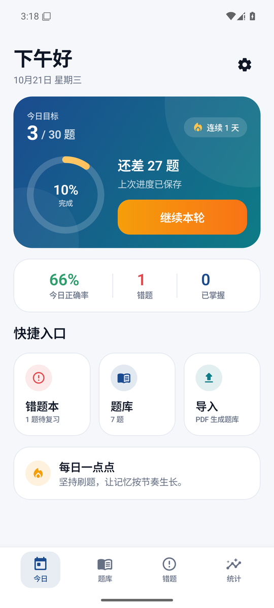
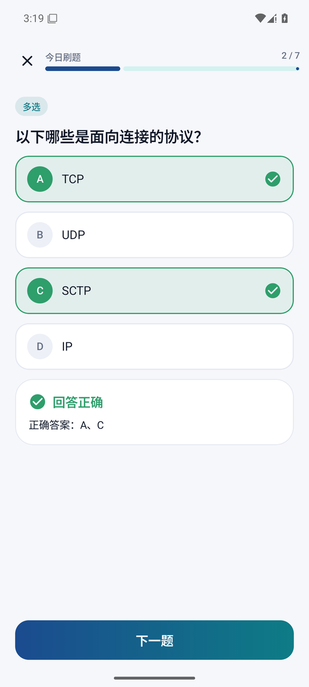
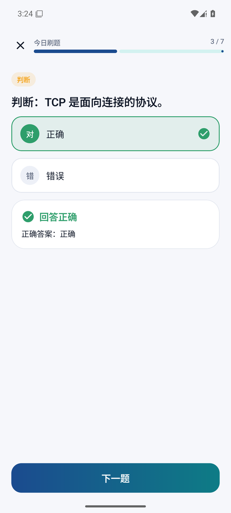
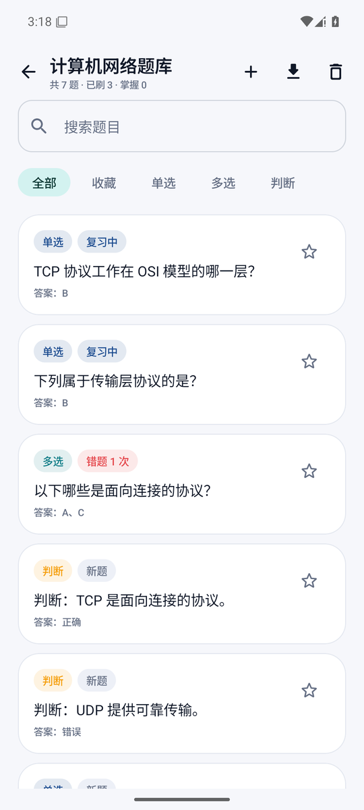
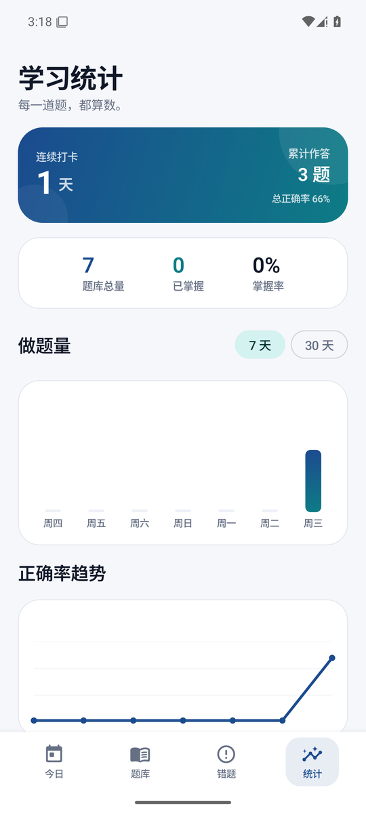

# 刷题星（ShuaTiXing）

一款**完全离线**的 Android 刷题应用：导入文字版 PDF 题库，自动提取题目与答案，按改良艾宾浩斯节奏安排每日刷题，答错的题循环重测直到答对，并自动收进错题本。

无需账号、不联网、数据只保存在本机。

## 截图

| 今日 | 刷题 |
|---|---|
|  |  |

| 单选/判断点击即判分 | 题库进度 |
|---|---|
|  |  |



## 功能

- **PDF 导入**：自动识别题号、选项、答案、解析；清洗页眉页脚与页码；导入前逐题校对，可编辑、删除、补答案、去重
- **题型**：单选、多选、判断，自动判分（单选与判断点选即判）
- **每日刷题**：题量可设（默认 30），按「到期错题 → 到期复习 → 新题」组卷
- **错题重测**：答错的题排到本轮末尾，答错继续循环，答对才结束当天计划
- **复习调度**：改良艾宾浩斯间隔 1 / 2 / 4 / 7 / 15 / 30 天，答错重置并次日复习
- **错题本**：连续答对 2 次自动移出，支持错题专项练习
- **题库管理**：搜索、题型筛选、收藏、手动添加/编辑题目
- **统计**：连续打卡、每日做题量、正确率趋势、月度打卡热力图、题库掌握度
- **题库分享**：导出 `.json` 题库给朋友，或从文件导入
- **做题记录导出**：把当前题库所有题的作答情况（答错次数、下次复习日期、作答次数、正确率、状态等）导出为 Markdown 报告，方便归纳错题或交给大模型分析
- **深色模式**、大字体适配、进度自动保存

## 技术栈

| 层 | 选型 |
|---|---|
| 语言 / UI | Kotlin + Jetpack Compose (Material 3) |
| 架构 | 单模块分层：`parser / domain / data / ui`，手动依赖注入 |
| 存储 | Room（题库、复习状态、作答记录）+ DataStore（设置、会话） |
| PDF | [PdfBox-Android](https://github.com/TomRoush/PdfBox-Android) 本地文字提取 |
| 图表 | Compose Canvas 自绘 |
| 最低版本 | Android 8.0（API 26），targetSdk 35 |

## 下载安装

到 [Releases](../../releases) 下载最新 APK，在手机上允许「安装未知来源应用」后安装即可。

- 覆盖升级不会丢失数据（包名与签名保持一致）
- 题库可在「题库详情 → 导出」备份为 `.json`，注意导出内容不含个人刷题记录

## 构建

需要 JDK 17、Android SDK 35。

```bash
# 本地需要 local.properties，内容为 sdk.dir=/path/to/android-sdk
./gradlew :app:assembleDebug

# 单元测试（55+ 个，纯 JVM）
./gradlew :app:testDebugUnitTest

# 设备/模拟器测试（Room、PDF 提取）
./gradlew :app:connectedDebugAndroidTest
```

发布签名：在项目根目录创建 `keystore.properties`（已被 git 忽略）：

```properties
storeFile=/absolute/path/to/keystore.jks
storePassword=******
keyAlias=shuatixing
keyPassword=******
```

然后 `./gradlew :app:assembleRelease`。

## 项目结构

```
app/src/main/java/com/shutixing/app
├── parser/      PDF 文字提取、文本清洗、题目结构化（纯 Kotlin，可单测）
├── domain/      模型、判分、艾宾浩斯调度、组卷、会话引擎、统计
├── data/        Room 实体与 DAO、仓库、题库 JSON 导入导出
├── di/          手动依赖容器
└── ui/          Compose 页面（首页、刷题、结果、错题本、题库、导入、统计、设置）
```

设计文档与实现计划见 [docs/superpowers/](docs/superpowers/)。

## 已知限制

- 仅支持**文字版 PDF**；扫描件/图片版需要 OCR，暂不支持
- 题目内嵌图片不会提取（校对页可删除该类题）
- 填空题、简答题等主观题暂不支持

## 隐私

应用不申请网络权限，不做任何上传或统计；卸载即删除全部数据。

## License

[MIT](LICENSE)
